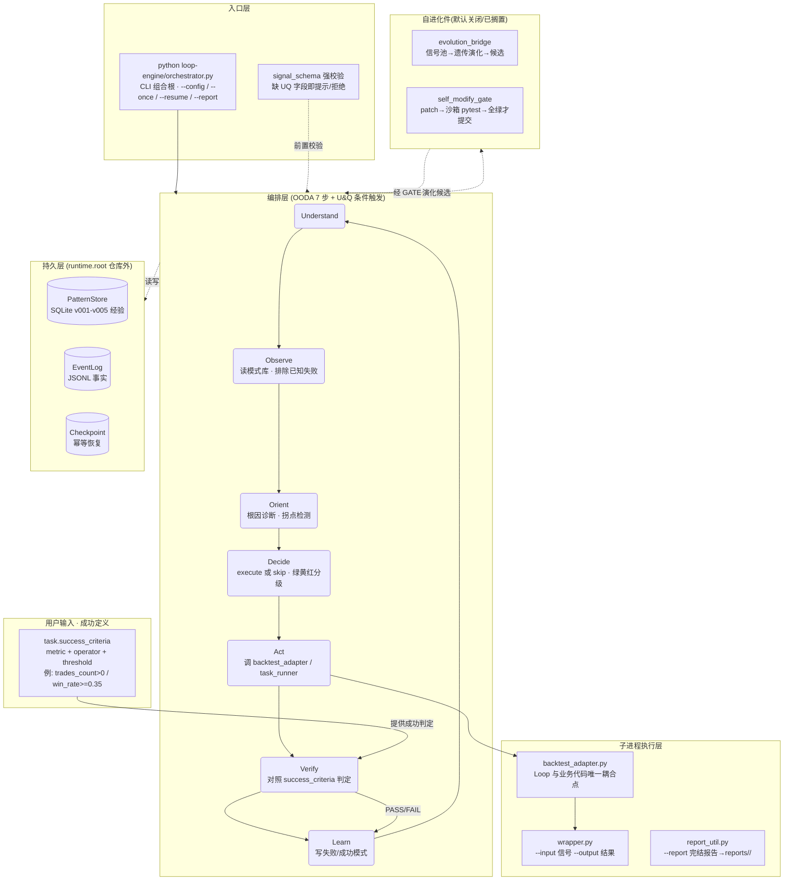
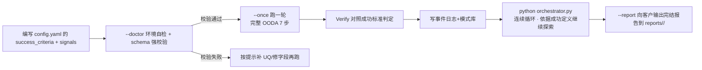
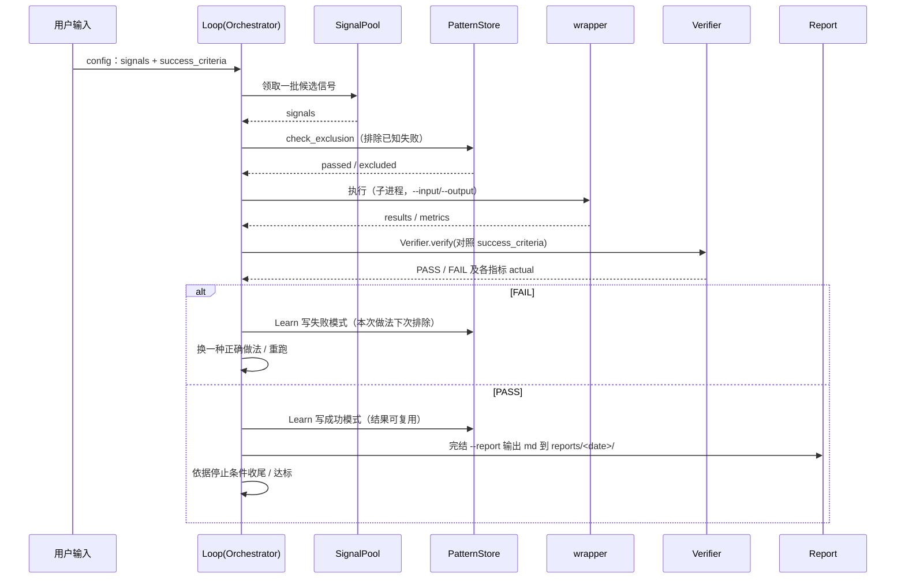
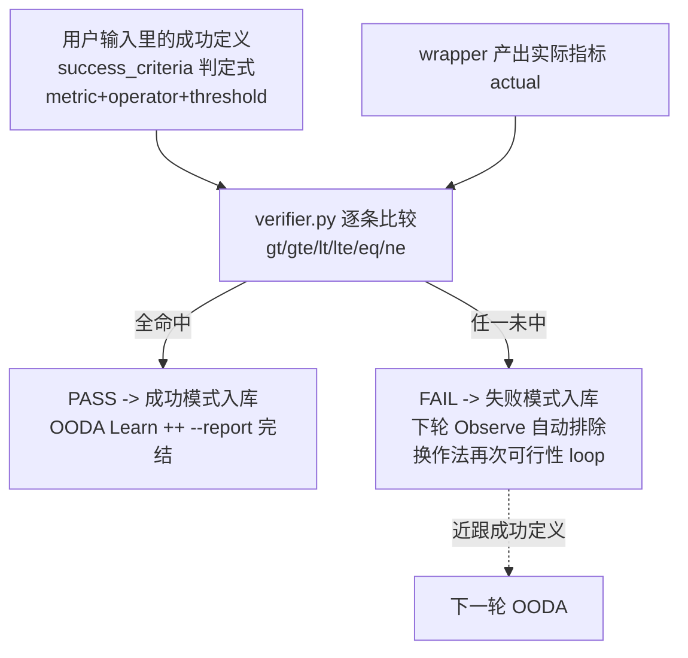
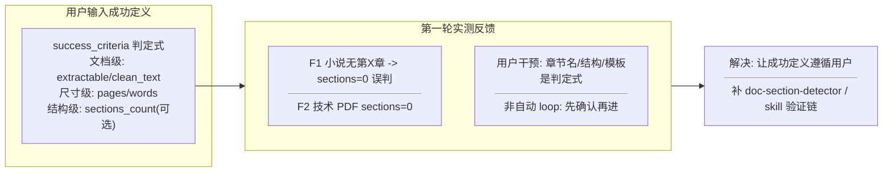
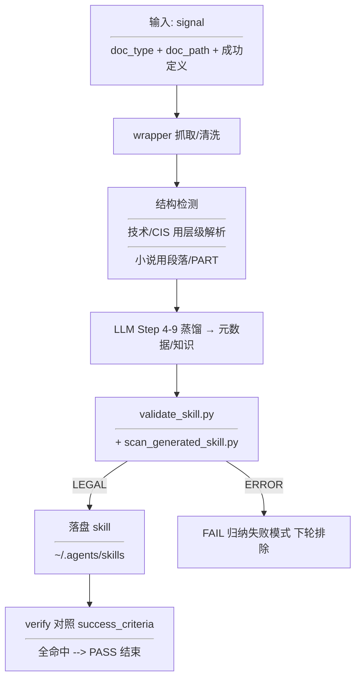
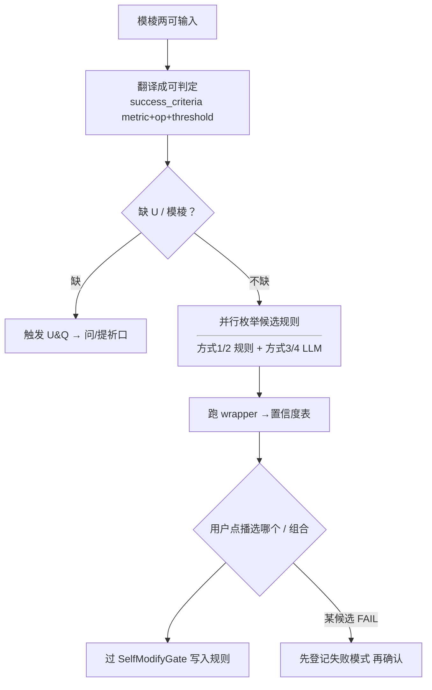

# loop-dev · 自进化编排引擎（完整项目介绍 2026-09-02）

## 1. 结论

loop-dev 是一个 CLI 驱动的**自进化编排引擎**（不是绑定量化的框架），核心是「用户定义成功、Loop 自主逼近」：你在输入里写明什么算成功（success_criteria 判定式），Loop 用 OODA 7 步自主循环去探索执行、逐轮对照成功判定，失败自动沉淀为排除经验、成功复用为优先信号，把确定性简单结果（如 1+1=2）一次命中，把复杂目标通过多轮可行性 loop 逼近达标；运行产物隔离在仓库外 runtime.root。当前 v4.0-dev：**701 passed / 1 skipped / 1 xfailed，coverage 69.72%**（>64 fail_under）；自进化第1档（信号演化）与第2档首块（SelfModifyGate 自改码门禁）已实现，但其**整体自进化已按用户决定【搁置】**（资源受限不实时运行），唤醒路径已写入 ROADMAP；系统完整性基线（--report 完结报告、U&Q 条件触发、输入信号 schema 强校验）已落地；真实 lh 量化 pilot 与 book-to-skill 内容生产场景均已接通。

## 2. 全景架构图

这是 loop-dev 的**全景架构**：CLI 驱动的**自进化编排引擎**。核心是一条「由用户定义成功标准、由 Loop 自主循环逼近达标」的闭环：编排器领到一批信号后，跑 OODA 7 步，调子进程回测/执行脚本产出结果，由 Verifier **对照用户定义的 success_criteria 判定成败**，失败自动沉淀为下次的排除经验、成功被复用为优先信号。运行产物隔离在仓库外的 runtime.root。



核心约定：EventLog=事实、Checkpoint=控制、PatternStore=经验视图，三者严格分离；越界路径由 containment 拒绝（fail-closed，这是设计预期不是 bug）；自进化件默认关闭、须过沙箱 pytest 门禁才提交生产。

## 3. 架构分层与模块地图

| 层/模块 | 职责 | 证据 |
| --- | --- | --- |
| loop-engine/orchestrator.py | CLI 组合根：加载配置 + 编排 OODA + 输入信号 schema 强校验 | ~680 行（godfile 拆分后） |
| loop-engine/evolution_bridge.py | 自进化第1档：信号池→遗传演化→候选产出 | tests/test_evolution_bridge.py 12 passed |
| loop-engine/evolution_loader.py | Orchestrator mixin：evolve_signals / review_candidates（默认关） | 构造即初始化 enabled=false |
| loop-engine/self_modify_gate.py | 自进化第2档首块：SelfModifyGate 沙箱 pytest 门禁原语 | tests/test_self_modify_gate.py 11 passed |
| loop-engine/signal_schema.py | 输入信号 schema 强校验（fail-closed 前置） | --doctor 期校验 |
| loop-engine/report_util.py | --report 完结报告：向客户输出 md + 规范目录 | projects/.../reports/<date>/REPORT.md |
| loop-engine/ooda_pipeline.py | OODA 7 步编排 + U&Q 条件触发 | U 未入户则提示/Q 条件触发 |
| loop-engine/run_once_pipeline.py | 单轮 execute→Verify→Learn 管线 | L304 读 success_criteria 默认 |
| loop-engine/verifier.py | 逐条对照 success_criteria 判定 PASS/FAIL | verifier.py verify() |
| loop-engine/memory_store.py | SQLite 模式库（失败/成功经验）v001-v005 | 541 行 |
| loop-engine/event_log.py | JSONL 事件日志（只追加，事实源） | 294 行 |
| loop-engine/round_context.py | 跨轮上下文传续（包装器错误跨 Act→Orient 断链） | v2.2 |
| loop-engine/adapters/backtest_adapter.py | Loop 与回测代码唯一耦合点（I/O 隔离 io_dir） | L191 configure + evolution io_dir |
| loop-engine/adapters/task_runner.py | TaskRunner ABC + BacktestRunner | L305 metrics |
| loop-engine/runtime_paths.py | fail-closed 路径隔离（断言在 runtime.root 内） | assert_under_root |
| loop-engine/runtime_exec.py | ExecGate：去 shell + 解释器白名单 | 114 行 |
| loop-engine/circuit_breaker.py | 熔断半开多探针恢复 | 107 行 HALF_OPEN |
| loop-engine/resume_guard.py | 断电/崩溃恢复幂等 | 82 行 |
| loop-engine/hooks_check.py | Claude Code 前置钩子（回测提醒/模式库编辑拦截） | PreToolUse |
| loop-engine/hook_protocol.py | HookOutput 标准化输出协议 | protocol |
| loop-engine/corrections/pre_check.py | R1-R6 校正规则校验 | playbook |
| backtest/ | 回测脚本契约（mock/lh_backtest/lh_runtime） | mock_backtest.py 契约 docstring |
| scripts/ | 门禁 + 脚手架（run_gate/make_pilot/make_pm_task_config） | scripts/run_gate.py |
| projects/<domain>/<task>/ | 业务场景接入根（config+signals+wrapper+candidates/reports） | projects/pm/_template |
| docs/ | 手册/版本/路线/PM 接入规范/知识库互通 | docs/loop-dev-QUICKSTART.md |
| _data/ | 子进程 I/O 契约落点（loop_backtest_input/output.json） | backtest_adapter 契约 |

## 4. 任务运行与自主 loop 流程

从**设计者视角**看，一次任务与它「依据成功定义自主 loop」的完整流程。

**1. 用户怎么运行一次任务** —— 在 config 里定义成功标准，先环境自检 + schema 强校验，再跑单轮，或进入连续循环：



**2. 任务怎么自主做可行性 loop，逐步近跟成功判定式的结果** —— 每一轮都是「取信号 → 排除已知失败 → 执行 → 对照成功标准判定 → 学习」；未达标被记录、下次调整参数/做法再试，逐步逼近用户定义的成功：



**3. 用户怎么查询历史任务** —— 过程与结果都能回看：


## 5. 成功判定机制 · 用户定义·Loop 逼近

**Loop 的成败由用户在输入里定义，Loop 只负责按这个定义去可行性 loop 探寻执行**——这是它区别于普通脚本/Agent 引擎的本质。

### 5.1 用户在输入里写「什么是成功」（两级定义）
**成功值 = 判定式，不是必然值**：确定性结果（如 `1+1=2`）是事件的必然结果，一次命中即成，无需探索；但客户要的往往是**复杂结果**——`1+1` 该等于几本身不重要，重要的是「哪种结果才算成功」的判定式。Loop 就把这个判定式当作可行性的标尺。

写成 `task.success_criteria`（至少 1 条，PM 模板要求 ≥3 条），每条是 `metric + operator + threshold`：
- `trades_count > 0`：只要产生交易就算过（简单门槛，未配置时 Loop 内置此默认，见 `run_once_pipeline.py` L304）；
- `win_rate >= 0.35`、`sharpe >= 1.0`、`filter_effectiveness > 0`：业务级成功；
- operator 仅限 `gt/gte/lt/lte/eq/ne`，threshold 必须数值，不允许「尽量/大约」；指标名必须对应 wrapper 输出（见 `projects/pm/_template/config.yaml`）。

更严格的正确性判定走 `verification.assertions`（可选，`equals/range/regex/exists/min_size/callback`），判「结果是否正确」而不只是「执行是否完成」。

### 5.2 Loop 按成功定义做可行性 loop 探寻执行
- 每轮取信号 → 排除已知失败（Observe）→ 执行（Act）→ **由 `verifier.py` 逐条把实际指标和成功定义比较（gt/lt/gte/lte/eq）**，对不上标 FAIL、全对上标 PASS。
- **未达标 → FAIL 自动沉淀为失败模式入库**，下一轮观察时自动排除，换更接近成功定义的作法再试——这就是「可行性 loop」：不是撞运气，而是带着上次失败的原因持续逼近用户定义的成功。
- **达标 → PASS 复用为成功模式**，减少重复探索；随即 `--report` 向客户输出完结报告。
- 判定结论（PASS/FAIL + 各指标 actual）写回事件日志/模式库，可被 `--status`、`--inspect round` 查询。

### 5.3 判定成功的三层约定（把「成功值」写清楚）
1. **必然值**：可直接断言（如结果等于 X），一次命中。
2. **判定式**：`metric+operator+threshold` 逐条比较，复杂目标多轮近跟。
3. **断言集**：`verification.assertions` 判「结果是否正确」。



## 6. 质量维度覆盖矩阵

| 维度 | 状态 | 证据 | 风险 |
| --- | --- | --- | --- |
| architecture | covered | orchestrator ~3300→680（ADR-006/007）+ 演化组件分层接入 | low |
| success-eval | covered | verifier.py + run_once L304 success_criteria 判定 + 用户定义成功两级 | low |
| self-evolving | partial | 第1档 signal 演化 + 第2档 gate 已实现；但整体自进化已【搁置】（资源约束不实时跑），保留唤醒路径 | low |
| test | covered | tests 全量 701 passed / 1 skipped / 1 xfailed | low |
| coverage | covered | coverage 69.72% > fail_under 64 | low |
| reporting | covered | --report 完结报告已实现，输出目录规范在 projects/.../reports/<date>/ | low |
| data | covered | provenance SHA + checkpoint 硬校验 + 演化 io_dir 隔离 | low |
| docs | covered | QUICKSTART/ROADMAP/项目介绍 + 本完整报告 | low |
| ci | partial | 本地 run_gate 可绕过，未接远程不可绕过 CI | high |
| ops | partial | dev containment 有；系统级 sandbox 未做 | medium |
| platform | partial | REST/Webhook/WebUI/多项目未做 | medium |
| contract | covered | 四层约束 Budget/Stop/Scope/Zone + 输入信号 schema 强校验 | medium |

## 7. 各模块详细分析

### 7.1 success-verifier
- 原则: 用户定义成功，Loop 判定逼近
- 证据: verifier.py + run_once L304
- 风险分级: low
- 下一步: 推广到更多任务 config

### 7.2 self-evolving-loop
- 原则: 第1档信号演化 + 第2档自改码门禁原语，OODA 7 步 + 失败沉淀/成功复用
- 证据: evolution_bridge/loader + self_modify_gate.py
- 风险分级: low
- 下一步: 整体自进化【搁置】，唤醒路径见 ROADMAP

### 7.3 containment-exec
- 原则: fail-closed 路径 + ExecGate 解释器白名单
- 证据: runtime_paths + runtime_exec
- 风险分级: medium
- 下一步: 系统级 sandbox

### 7.4 circuit-breaker
- 原则: 半开多探针恢复
- 证据: circuit_breaker.py HALF_OPEN
- 风险分级: low
- 下一步: 接入 CI 联测

### 7.5 input-schema
- 原则: 输入信号 schema 强校验，缺 UQ 字段即提示/拒绝
- 证据: signal_schema.py + --doctor
- 风险分级: low
- 下一步: 推广到所有输入阶段

### 7.6 reporting
- 原则: 任务完结必向客户输出 md 报告，目录落 projects/.../reports/<date>/ 不落 C 盘
- 证据: report_util.py + projects/book-distill/reports/2026-09-02/REPORT.md
- 风险分级: low
- 下一步: orchestrator --report 自动化扩展

### 7.7 pm-onboarding
- 原则: PM 框架接入（T1-T5 可判定）
- 证据: PM 规范 + _template + make_pm_task_config
- 风险分级: low
- 下一步: 回归 PM 测试（已搁置，逐个完成）

### 7.8 data-provenance-contract
- 原则: 运行产物只写 runtime.root；I/O 走 _data 契约；演化用独立 io_dir
- 证据: runtime_paths + _data/ + evolution io_dir
- 风险分级: low
- 下一步: 补发包后 provenance 一致性审计

### 7.9 contract-programming
- 原则: 四层约束 Budget/Stop/Scope/Zone + 输入 schema 强校验
- 证据: orchestrator _check_contract/_check_scope/_decide
- 风险分级: medium
- 下一步: 把 Zone 分级落到 config 示例并文档化

## 8. 问题点汇总统计

| 风险级 | 计数 | 涉及维度 |
| --- | --- | --- |
| critical | 0 | - |
| high | 1 | ci |
| medium | 3 | - |
| low | 8 | - |

覆盖状态：covered=8 partial=4 N/A=0 missing=0

## 9. 改进方案 — 阻塞项详述

### 9.1 B1
(fail-closed CI 接入)
- 现象: 本地 run_gate 可绕过；无远程不可绕过门禁
- 根因: 无 hosted/pre-receive CI；未做 secret/path 扫描
- 影响: 生产发布无法宣称绿色；多机协作污染风险
- 验证: 绕过本地 hook 仍无法 push 非绿色；敏感/路径污染被拒

### 9.2 B2
(migration sentinel RPO)
- 现象: rpo 用 row_count_proxy
- 根因: 未在业务行加 sentinel(committed_at)
- 影响: 无法宣称恢复到业务时间点
- 验证: 演练给 committed_at<=cutoff 时间点；RTO 实测

### 9.3 B3
(整体自进化接线(第2档L2元循环→pytest→提交))
- 现象: 第1/2档原语已实现但未接成完整反馈式自进化
- 根因: 当前 PC 资源受限不实时跑，已声明搁置
- 影响: 暂无法 7×24 自主进化；唤醒需资源达标
- 验证: 接 L2 建议→propose patch→SelfModifyGate 全绿才提交

### 9.4 B4
(REST/Webhook/WebUI 平台化)
- 现象: 仅 CLI；外部无法直接驱动 Loop 或查历史
- 根因: 未做 REST API / Webhook / WebUI
- 影响: 多机协作、自动化接入受限
- 验证: REST 驱动 --once + 查询模式库；Webhook 回调

### 9.5 B5
(OS/network sandbox)
- 现象: 仅 dev containment（路径断言）
- 根因: ExecGate 之上无系统级沙箱/默认禁出网
- 影响: 暴露不可信输入/生产无隔离
- 验证: 逃逸/网络越权被系统级拦截

## 10. 使用者视角 · 运行任务 / 查询历史 / 自主 loop

**使用者视角 · 上手与日常操作**（完整命令速查）。

### 10.1 环境准备（一台新主机）
`py -3.11 -m venv .venv` → 装 `PyYAML` / `pytest==9.1.1` / `pytest-cov==7.1.0` / `coverage==7.16.0` → `python scripts/make_pilot_config.py --runtime-root <本机路径>` 生成本机隔离配置。`${RUNTIME_ROOT}` 是唯一按主机填的占位符，必须字面量绝对路径、不解析环境变量。

### 10.2 定义成功（这是 loop 的核心入口）
在 config.yaml 的 `task.success_criteria` 里写 `[{metric, operator, threshold}, ...]`：至少 1 条（PM 模板要求 ≥3 条）；operator 仅 `gt/gte/lt/lte/eq/ne`；threshold 必须数值。简单结果写 `trades_count > 0`；业务级写 `win_rate >= 0.35`、`sharpe >= 1.0`。更严格判定用 `verification.assertions`。

### 10.3 运行一次任务
`python loop-engine/orchestrator.py --config <config> --doctor`（环境自检 + schema 强校验）→ `--once`（完整 OODA 一轮：Act→Verify 对照成功标准判 passed→Learn 记录模式）→ 达标后 `--report` 输出完结报告到 `projects/<domain>/<task>/reports/<date>/`。

### 10.4 查询历史任务
`--history` 运行历史；`--status` 模式库/问题队列；`--inspect runs|timeline|last-error|round --round N` 事件日志；`--trace` 生成本地静态 HTML 报告。

### 10.5 连续 loop / 恢复 / 审核
- 连续：直接 `python loop-engine/orchestrator.py`（受 `max_rounds/max_seconds/no_progress_stop` 约束）。
- 恢复：`--resume` 断电后从 checkpoint 续跑（幂等）。
- 审核：`--review --yes --scope combo` 人工把失败升级为排除规则（**不会自动改 status**）。

### 10.6 验证门禁（提交前）
- 单元测试：`pytest tests/ loop-engine/tests/ --ignore=tests/test_p0_2_rerun.py`（701 passed）。
- 门禁：`python scripts/run_gate.py`（coverage≥64%，只升不降，当前 69.72%）。
- 新任务自检：改 wrapper/config/signals 后跑 `--doctor` 通过绿勾 + schema 校验通过再继续。

### 10.7 术语速查
- `success_criteria`：用户在 config 里定义的成功判定式（metric+operator+threshold）。
- `verification.assertions`：可选的结果正确性断言。
- OODA 7 步：Understand→Observe→Orient→Decide→Act→Verify→Learn。
- `runtime.root`：仓库外运行产物根，隔离与可移植的边界。
- 完结报告：`--report` 向客户输出 md，目录规范在 `projects/<domain>/<task>/reports/<date>/`（不落 C 盘）。

## 11. 关键发现

**核心机制**：任务 = 用户在 config 里定义成功标准（`success_criteria`）+ 信号 + 执行脚本；Loop 通过 OODA 7 步自主 loop **逼近该成功判定**——未达标 FAIL 自动沉淀为 failure pattern（下轮 Observe 自动排除）、达标 PASS 复用为 success pattern；判定由 `verifier.py` 逐条比较 actual（gt/gte/lt/lte/eq/ne），L2 只给规则建议、不自动改 status（需人工 `--review`）。

**输入信号强校验**：`signal_schema.py` 在入口对输入信号做 schema 强校验，缺 UQ（未知/查询）字段即提示或拒绝——fail-closed 前置，杜绝坏输入进入编排。

**完结报告规范**：任务完结必向客户输出 md（`--report`），目录落在 `projects/<domain>/<task>/reports/<date>/`，不写 C 盘、交给客户的交付物有规范落点。

**自进化（已搁置）**：第1档半自主信号演化（`evolution_bridge.py` + `--evolve`/`--rev-candidates`）与第2档首块 SelfModifyGate 沙箱门禁已实现并单测通过；但整体反馈式自进化（L2 元循环→propose patch→过 gate 提交生产）**按用户决定搁置**——当前资源受限不实时运行，唤醒路径已写进 `docs/loop-dev-ROADMAP.md`。

**关键隔离**：执行脚本用仓库内相对路径、运行产物落 `runtime.root`（仓库外），越界触发 ContainmentError 即 fail-closed；演化期 fitness 回测用独立 io_dir 避免并发覆盖。

**工程基线**：orchestrator.py 从约 3300 行拆到约 680 行（ADR-006/007）；fail-closed containment + ExecGate；熔断半开多探针；输入 schema 强校验；--report 完结报告。

**测试**：701 passed / 1 skipped / 1 xfailed，coverage 69.72%（>64）。真实 lh 量化 pilot 与 book-to-skill 内容生产场景均接通。

**与知识库互通**：`successCriteria` 两门验证模型（success_criteria + verification.assertions）源自 loop-verification-design.md，「编排器不是计算器」的分工源自 PM框架-接入loop-dev-流程规范.md §0。

## 12. 加固建议

**当前主线（已完成/在途）**：打磨执行完报告输出（`--report` 向客户输出 md + 规范目录）、输入信号 schema 强校验（已开）、把 loop-dev 当作完整系统做全面评估与改造方案（已写入知识库后续开发进度）。

**分阶段补齐（已按优先级排序）**：
- P0（生产前置，必须马上完成）：执行完结报告输出；输入信号 schema 强校验；fail-closed CI（复用 pyproject fail_under=64 只升不降，补 staged secrets/绝对路径扫描）。
- 让成功判定可举证：migration sentinel 把 RPO 从行数代理升级为业务时间点（committed_at）。
- P1/P2（延后、触发才唤醒）：OS/network sandbox（默认禁出网）、REST API 平台化（外部驱动 Loop、查模式库）、WebUI dashboard；整体自进化唤醒。

**约束**：只动 loop-dev、不碰旧基线 loop；Pattern 默认证据、Rule 默认审批后控制；所有断言附真实文件/命令证据，先测后写禁编造。

## 13. 下一步

按用户既定优先级：**近期唯一在途** = 先把项目自主进化件收尾（已实现件保留复用、可先提交），再做代码健康度整理与项目介绍/规划文档；PM 框架测试与改名全面搜索**已搁置**，一个个完成不并行。

**唤醒路径（触发条件达标才执行）**：fail-closed CI、migration sentinel RPO、REST/Webhook、sandbox、WebUI、整体自进化（需资源达标）——见 `docs/loop-dev-ROADMAP.md`。

**本报告产出**：已用 ai-skill-output-template 的 project.overview 模板重生成完整项目介绍，标题统一技术论文式编号（一级`## N`→二级`### N.N`→三级`#### N.N.N`，三级封顶），禁圈号。接手顺序见 ROADMAP §5。

## 14. 实测复盘：book-to-skill 第一轮（目的 / 遇到的问题 / 解决 / 为何非自动 loop）

以下来自实际跑通的产物：`projects/book-distill/reports/2026-09-02/REPORT.md`、`REVIEW.md`、`animal-farm.md`、`cis-debian.md`、`frida.md` 以及 `projects/book-distill/config.yaml`。

### 14.1 用户目的
验证 book-to-skill 解析**不同类型文档（技术文档 / CIS 标准 / 小说 / 等）不是走同一个输出模板**，并校验生成 skill 的有效性。因此用三份真实文档分别用「各自的」成功定义（输出模板）进行测试。

### 14.2 三个真实场景与各自的成功定义
| TID | 类型 | 路径 | success_criteria | 结果 |
|-----|------|------|------------------|------|
| animal-farm | 小说(叙事)·txt | D:\\book\\booktest\\txt\\.txt | extractable eq True; clean_text eq True | 3/3 PASS |
| frida | 技术文档·PDF | D:\\book\\booktest\\pdf\\Frida.pdf | extractable eq True; pages gte 50; words gte 1000 | 3/3 PASS |
| cis-debian | CIS 标准·PDF | D:\\book\\booktest\\pdf\\CIS_Debian_Linux_12_Benchmark_v1.0.1.pdf | extractable eq True; pages gte 100; clean_text eq True | 3/3 PASS |

> 具体数据：animal-farm words=1569/pages=24/sections_count=10；frida words=17790/pages=375/sections_count=0；cis-debian words=67507/pages=1011/sections_count=329。这证明不同文档各自走各自的解析逻辑，不是单一模板。

### 14.3 第一轮出现的问题（遇到的坑）
- **F1 小说结构判缺**：animal-farm 的 txt 无“第X章”标题，wrapper 把 `sections_count` 判为 0 → 视为结构缺（本地被当作 FAIL 记录）。但用户指出：“小说可能就没有标题吗？他是 txt 的版本”——即结构判定不应强求“第X章”。
- **F2 技术文档 sections_count=0**：frida PDF 无明确章节性标题，与 CIS 对比时自动被判 0。
- **F3 wrapper 内部支射缺 LLM Step 4-9**：book-to-skill 的蒸馏步骤未真正执行，输出 skill 有效性未被算法验证。
- **REVIEW 暴露 REPORT.md 本身违规 L0**：缺 frontmatter 7 字段、validate 无法匹配 template（容器 book-distill.report 曾含 BOM 导致 JSON 解析失败）、空 narrative → 初期 validate 输出 **INVALID**。

### 14.4 遇到问题怎么解决
- **让成功定义遵循用户而非结构一刀切**：把 success_criteria 设为 `extractable/clean_text` 等文档级判定，英文不强求章节数。
- **补 doc-section-detector（N1 待办）**：结构解析同时识别“段落结构”型文档（小说/技术手册）的小标题/PART，不再按“第X章”一刀切。
- **补 skill 有效性校验链（N3 待办）**：book-to-skill 完整 Step 4-9 由 LLM 走 `validate_skill.py` + `scan_generated_skill.py`，LLM 输出 ERROR 即 fail。
- **REPORT.md 输出规范化（已做）**：案 book-distill.report 补齐 frontmatter 与材料，`validate.mjs` 输出 `valid[book-distill.report]` exit 0。

### 14.5 为何这次非自动 loop
因为这一轮的关键决策点是“什么算成功的判定式”而非“执行结果”：
- 小说有无“第X章”、CIS 用 1.1/1.1.1 层级、技术文档用关键词模板——这些是用户主观判断，应由用户在输入里定义。
- loop 的职责是按成功定义去可行性 loop 探许执行，而不是替用户决定“结构是否正确”；L2 只给规则建议、不自动改 status（需人工 `--review`）。
- 因此本轮不带自动 loop 盲跑，先由用户确认成功定义与模板再进，避免把误判当“失败”反复 loop。这正是“编排器不是计算器”、“用户定义成功”的设计初衷的具体场景。


### 14.6 交付与 skill 路径（可直接测试）
- 结果产物：`projects/book-distill/reports/2026-09-02/REPORT.md`、`REVIEW.md` + 每 TID 单局报告 `animal-farm.md`/`cis-debian.md`/`frida.md`；I/O 落 `projects/book-distill/data/<tid>/loop_backtest_input|output.json`。
- **生成 skill 路径：`C:\Users\lvfushuai\.agents\skills\orwell-animal-farm\`（本次三 TID 共用同一些骤 skill 窗口，未分链落盘）——这路径在 C 盘为现有 skill 存放位，与 loop-dev 的输出规范不同。后续把“输出目录规范”引入 loop：交给客户的完结报告应落 `projects/<domain>/<task>/reports/<date>/`，不写 C 盘。
- 加固引入：本次 skill 有效性未被算法强校验，改走 `validate_skill.py` + `scan_generated_skill.py`（LLM 输出 ERROR 即 fail），保证生成 skill “测过才能写入”。
### 14.7 分 TID 的端到端流程（不同文档解析 / 怎样验证正确输出 / 任务结束判定）

**Step 0-10 通用架构（与 book-to-skill 对齐）：**



**三个 TID 各自的解析路径（不是同一模板）：**
- **animal-farm（小说·txt）**：以段落+小标题/PART 为结构级别（不强求“第X章”）；sections_count 为可选判定。本轮因 txt 无“第X章”被判 0，但成功定义如今只需 extractable/clean_text，故 3/3 PASS。
- **cis-debian（CIS 标准·PDF）**：以 1.1/1.1.1 层级解析章节（sections_count=329）；用 pages≥100 + 清洗判定，正确输出为“标准把握点截取 + 施策献匹配 + 默认不采纳也要确认”。
- **frida（技术文档·PDF）**：无明确章节性标题（sections_count=0）；以 extractable + pages≥50 + words≥1000 作为支撑判定。

- **任务结束判定：**不是“跑完就结束”，而是 `verifier.py` 把 wrapper 实际输出 actual 与 success_criteria 逐条比较；全命中→ PASS → 书写模式库、输出完结报告；任一未中→ FAIL 归纳失败模式。

### 14.8 输出目录规范化（本次打磨项）
- **问题：**本次生成 skill 落 `C:\Users\lvfushuai\.agents\skills\orwell-animal-farm\`（C 盘），与 loop-dev 的输出规范不同。
- **规范：**loop 交给客户的完结报告应落 `projects/<domain>/<task>/reports/<date>/`；I/O 应落 `projects/<domain>/<task>/data/<run-id>/`；不写 C 盘。
- **已做：**`report_util.py` 的 --report 已按此目录输出。本次 skill 在 C 盘是“现有 skill 存放位”，并非 loop-dev 的交付目录；后续把“输出目录规范”引入 loop 作为打磨项。

### 14.9 两条测试线并行进度（book-to-skill 已跑通 vs PM 已暁置）
- **book-to-skill：**已实测，3/3 PASS，skill 路径已萳盘（本报告 16.2/16.6 可共享测试），但未接算法验证链。
- **PM：**方案/模板/生成器已有（`projects/pm/_template` + make_pm_task_config）；待回归 T1 f2-purity 首验证——本段按用户决定“暁置”。
- **接手顺序：**先把自主进化件收尾/提交→再做代码健康度+项目介绍→然后回归 PM / 后续暁置项。
## 15. Loop 任务输入语义歧义 · 经典问题（在 book-to-skill 测试中暴露的通用问题）

本节记录

### 15.1 四种章节形态与层分
| 形态 | 格式 | 识别难度 | 归属 |
|---|---|---|---|
| 方式1 `第一章 xxx` | 明显 | 低 | 规则可覆盖 |
| 方式2 `1. xxx` | 明显 | 低 | 规则可覆盖 |
| 方式3 `xxxx` | 无编号小标题 | 高 | **模型理解能力（LLM 语义）** |
| 方式4 `《xxx》` | 书名号行 | 中-高 | **模型理解能力（LLM 语义）** |

**三层分工（Q2 的核心）：**
- 格式层：工程/工具钾（pdf 提取、epub 解包、编码）—— agent 编排下的工具能力；
- 结构层：**模型理解能力**（认出章节标记）—— 依赖 LLM 语义，方式3/4 不可写死；
- 判定层：**agent 编排能力**（把识别结果与 success_criteria 比对、判 PASS/FAIL/不 loop）—— loop 的本职。

“抽测 5 种类型、时代定义不同”属结构层（模型理解）；“用户给定义、loop 照着跑并判定达标”属判定层（agent 编排）。二者是分工，不是二选一。

### 15.2 问题三连问与答
**Q1：loop 进化是自主识别 还是用户点播？**
答：**半自主**。loop 自主枚举候选规则（信号演化 evolution_bridge），但“纳入”必须经“人工评审 --rev-candidates --yes”；“什么算章节”属用户/领域语义，loop 不盲自主。这对应“为何非自动 loop”。

**Q2：这属于模型理解还是 agent 编排？**
答：分工。“认出章节”=模型理解能力（结构层）；“按成功定义判定达标、去可行性 loop”=agent 编排能力（判定层）。方式3/4 基本不可写死，必须交给模型语义。

**Q3：模棱两可的选择，loop 怎么理解？**
答：四步。
1. **Step A 可判定化**：把模棱目标翻译成 success_criteria 判定式（`metric+operator+threshold`），禁“尽量/大约”，阈值必须数值。
2. **Step B U&Q 触发**：成功定义未传或模棱→触发 U（未知）/Q（查询确认点）→停下来人工确认；规则“传入给提示、未传提醒”。
3. **Step C 候选+点播**：对 4 种形态并行枚举候选规则（方式1/2 规则、方式3/4 LLM），各自跑 wrapper →置信度表 → 用户点播。
4. **Step D fail-closed + 沉淀**：某候选规则 FAIL → 不盲 loop（fail-closed），先登记失败模式、等确认再升级；确认后写入 wrapper（过 SelfModifyGate 沙箱测试）。


## 16. 运转内核：一次任务从输入到 PASS 的全过程（实现细节）

### 16.1 输入信号与 schema 强校验（fail-closed 前置）
输入为 `signals.json`（期勾信号清单）与 `config.yaml`（含 success_criteria）。入口先跑 `signal_schema.validate_signals()`：
- 核心字段：`signal_pattern`（必填、非空字符串）、`market_condition`（可选默认 `unknown`）；
- 任务 schema（`task.signal_schema.fields`）按类型验证；
- **success_criteria 指标一致性**：metric 要么在信号上、要么属 wrapper 已知输出集。
- U&Q：未传 U/Q 字段→提示/提醒；传入则不重复。

### 16.2 OODA 七步逐轮拆解
1. Understand：理解任务/config 、合约初始化；
2. Observe：自动读取 PatternStore、`check_exclusion()` 排除已知失败；
3. Orient：基于 RoundContext 做根因诊断、拐点预警；
4. Decide：绿黄红三区——绿执行、黄风险、红跳过/人工干预；
5. Act：`backtest_adapter` 调子进程 wrapper（L1 可重试）；
6. Verify：`Verifier.verify()` 逐条比较 actual 与 success_criteria；
7. Learn：原子事务写 failure/success + rounds + run_learns。

### 16.3 成功判定机制
用户在 config 定义 `success_criteria`（至少 1 条，PM ≈3）：`{metric,operator,threshold}`，operator 仅 gt/gte/lt/lte/eq/ne，threshold 必须数值；Verifier 支持 win_rate/sharpe/trades_count/metrics/task_result。更严格用 `verification.assertions`（equals/range/regex/exists/min_size/callback）。

### 16.4 记忆存储与自动载入（SQLite / JSONL / checkpoint）
主要文件：`memory_store.py`（67KB） + `event_log.py` + `run_state.py`； db 落 `runtime.root`（仓库外）。表：failure/success/rounds/problem_queue/run_history/run_checkpoints/run_learns/corrections/schema_versions。
- 经验 append/upsert 贯累，**不每次任务清空**；唯一删除是 `clear_checkpoint(run_id)`（run 完成/中止后清断点）。
- 自动读取：Observe 调 `load_failure_patterns/load_success_patterns/get_active_exclusion_rules/get_queue_stats` + `check_exclusion()`。
- 压缩：`pattern_compactor.py`；断点续跑：`resume_guard.py`；迁移：MigrationRunner + schema_versions。

### 16.5 上下文供给（“在正确时点为模型提供上下文”的落地）
- **RoundContext**（`round_context.py`）：跨轮结果传续；Act 状态/error/交易数、Verify 逐条设辈、L1 重试历史、事件门链，用于 Orient 诊断。
- **EventLog ContextSnapshot**（`event_log.py`）：Decide/Act/Verify 时对“模型看到了什么”做上下文快照—— JSONL 事实源。
- **prompt_renderer**（`prompt_renderer.py`）：动态注入当前 PatternStore 状态快照（total_rounds / failures / active_rules / top_failure_modes / stale_rules 等）到代理 prompt，用于 pre-backtest / post-backtest / meta-loop 模板。
- **合约与编排**（orchestrator）：四层约束 Budget/Stop/Scope/Zone 在每轮 Decide 审查，确保“正确时点”是编排决策。

数据流：信号→ `_data/loop_backtest_input.json` → wrapper → `_data/loop_backtest_output.json` → Verifier → EventLog/PatternStore。

## 17. 搭建（新主机 5 分钟按场景接入）

### 17.1 环境准备
```
py -3.11 -m venv .venv
.venv\Scripts\python.exe -m pip install PyYAML pytest==9.1.1 pytest-cov==7.1.0 coverage==7.16.0
```

### 17.2 生成本机隔离配置
```
python scripts/make_pilot_config.py --runtime-root E:/loop-runtime/pilot-lh
```
仅一个占位符 `${RUNTIME_ROOT}` 按主机填，必须字面量绝对路径、不解析环境变量。

### 17.3 环境自检
```
python loop-engine/orchestrator.py --config config.pilot-lh.yaml --doctor
# 预期 [OK] Contract probe: 3 trades
```
配置的 runtime.root / signals / db / io / events 全部向仓库外隔离。

## 18. 测试与门禁

### 18.1 单元测试
```
.venv\Scripts\python.exe -m pytest -p no:cacheprovider --no-cov -q tests/ loop-engine/tests/ --ignore=tests/test_p0_2_rerun.py
# 701 passed / 1 skipped / 1 xfailed
```

### 18.2 coverage 门禁（只升不降）
```
python scripts/run_gate.py          # fail_under=64，当前 69.72%
```

### 18.3 抽测体系
- P0 证明 P0 门禁有效、P0-抽测 TC4/TC5 、P9 测试场景全量列举（见 docs/ P0-* ）。
- 新任务自检：改 wrapper/config/signals 后必先 --doctor 绿勾透过再继续。

## 19. 场景接入模板

### 19.1 PM 任务（`projects/pm/_template/`）
```
python scripts/make_pm_task_config.py --task <task> --runtime-root <root>
# 生成 config.yaml + signals.json + wrapper.py；success_criteria ≥3 条
```

### 19.2 book-to-skill（`projects/book-distill/`）
三份真实文档各自走各自解析逻辑，共用一个 wrapper 的不同 doc_type 分支。

## 20. 安全与约束机制

### 20.1 四层约束（orchestrator _check_contract / _check_scope / _decide）
- Budget：硬/软两套阈值（max_rounds/max_seconds/no_progress_stop）；
- Stop：completion/safety 停止条件；
- Scope：allow/deny 路径白名单；
- Zone：绿黄红三区约束。

### 20.2 ExecGate 与 containment（fail-closed）
- `runtime_paths.assert_under_root`：绝对路径必须在 runtime.root 内；
- `runtime_exec.ExecGate`：去 shell、解释器白名单；
- 质越触发 ContainmentError，记录到 `events/security-audit.jsonl`。

### 20.3 熔断与恢复（circuit_breaker.py）
半开多探针恢复；连续失败达阈值→熔断、停止盲跑。
## 21. 语义歧义经典问题 · 完整知识（Loop 执行任务时的通用问题）

> 来源场景：2026-09-02 book-to-skill 测试。用户论及“解析 PDF 章节的多种形态”，这是很多人打逗 loop 执行任务时会遇到的通用语义问题。本文记录三个经典提问与拆解。

### 21.1 背景（四种章节形态）

用户给出四种章节形态：
- 方式1：`第一章 xxx` 这种很明显
- 方式2：`1. xxx` 这种很明显
- 方式3：`xxxx`（无编号的小标题）
- 方式4：`《xxx》`（书名号行）

且：不同格式（txt/PDF/epub）、不同时代（八股文分卷/回目/章回体/现代章节）、不同类型（技术/小说/CIS）章节定义不同。

### 21.2 问题 1：loop 进化是自主识别 还是用户点播

**答：半自主——loop 自主枚举候选 + 用户点播确认，不是纯自主。**

- loop 自主进化第1档（evolution_bridge）做“信号演化”：从信号池遺传地产出候选规则，但“纳入”必须经 `--rev-candidates --yes` 人工评审。
- 因“什么算章节”属用户/领域语义，loop 不能盲自主挺齐；它负责“枚举候选 + 测试验证 + 失败沉淀”，最后“拍板”用户点一下。
- 这对应用户早前说的“为何非自动 loop”：语义判断点 loop 不该盲自主。

### 21.3 问题 2：这属于模型理解还是 agent 编排

**答：拆成两层，分工，不是二选一。**

| 层 | 归属 | 例子 | 负责 |
|---|---|---|---|
| 格式层 | 工程能力 | pdf 提取、epub 解包、编码解码 | agent/工具链 |
| 结构层 | **模型理解能力** | 认出“第X章”？、`1.1`？、`《xxx》`书名行？ | **LLM 语义** |
| 判定层 | **agent 编排能力** | 把识别结果与 success_criteria 比对、PASS/FAIL/不 loop | **loop 编排** |

方式 1/2 可用规则，方式 3/方式 4 基本不可写死，需 LLM 语义判断。“抽测 5 种类型、时代定义不同”属结构层（模型理解）；“用户给定义、loop 照着跑并判定达标”属判定层（agent 编排）。

### 21.4 问题 3：模梳两可选择，loop 怎么理解

**Step A — 把“模棱两可”变成“可判定”（loop 的看家本领）**
- 用户的模糊目标翻译成 success_criteria 判定式（`metric + operator + threshold`）：例 `sections_detected >= 1`、`has_toc == true`、`structure_confidence >= 0.6`。
- 关键词“尽量/大约/不同”一律禁止；阈值必须数值。
- 若判定式本身“模棱两可”（例 sections_count 该不该算），loop 把它标为“待用户确认的语义决策点”，而不自己苛填。

**Step B — 未知/不明（U&Q）条件触发**
- 用户未说明“章节按哪种方式定义” → loop 触发 U（未知）→ 主动问/补 prompt；
- 用户提供候选但说“你看着办” → loop 把“模棱两可”当 Q（查询/确认点）→ 停下来人工确认，不硬猜。
- 规则：**传入就给提示，未传就提醒**，不省这一环。

**Step C — 多方案候选 + 用户点播**
- 对 4 种形态，loop 并行产出候选规则（方式 1/2 用规则、方式 3/4 交给 LLM 语义），各自跑 wrapper → 各自给 sections_count/置信度 → 列成对比表 → 用户点播选哪个/哪个组合。

**Step D — fail-closed + 失败沉淀**
- 某候选规则跑 FAIL（例小说章节判 0） → 不继续盲 loop，先登记失败模式，等用户确认“这其实是正确的（小说本无章）”再升级规则；
- 一旦确认，写入 wrapper（过 SelfModifyGate 沙箱测试）→ 以后该类型不再误判。

### 21.5 为何这是“经典”问题

- 很多人把语义判断误归给 loop“自主”，实际上语义属模型理解、编排属 loop；
- “模棱两可”不是“失败”，是“待确认”——loop 应触发 U&Q 而非盲 loop；
- 规则能写死的不让模型懂，规则写死不了的交给模型语义、顺序与分工要明确。
