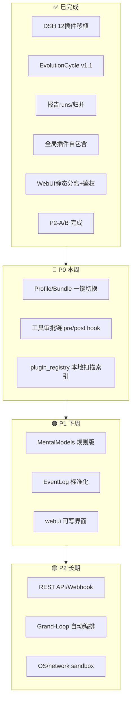
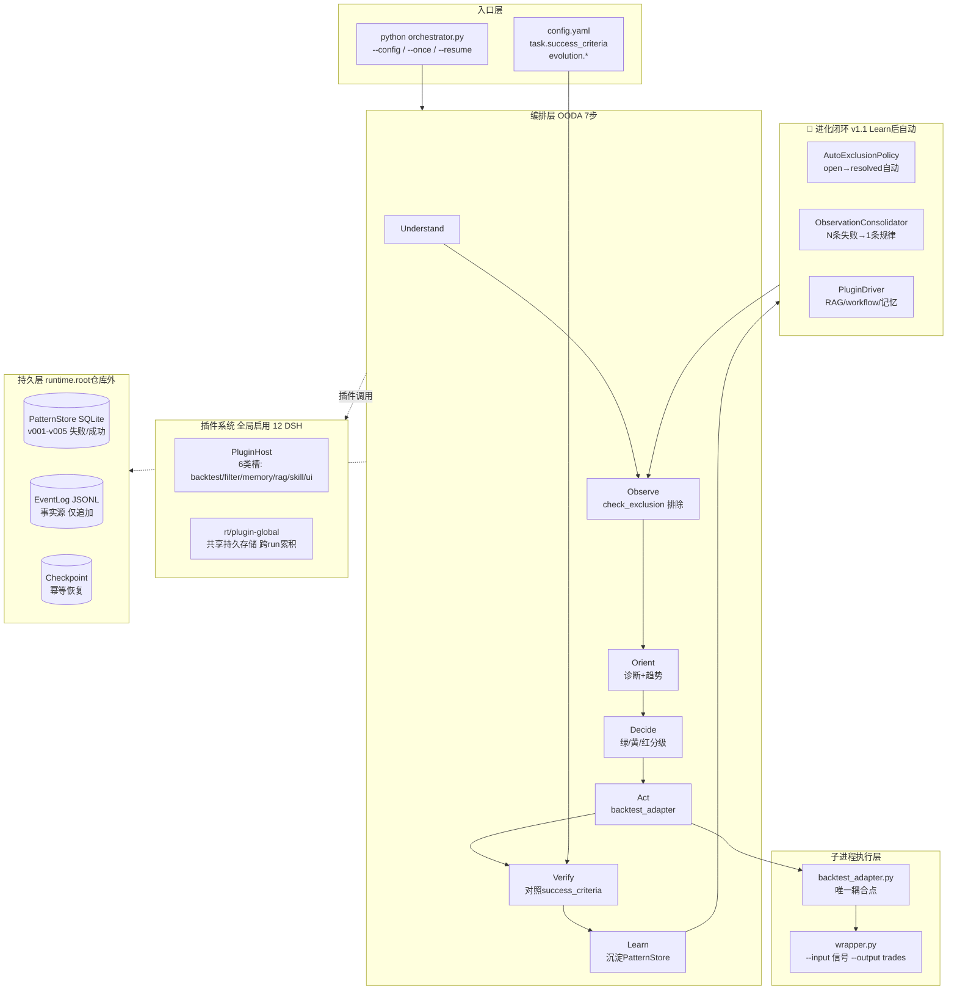
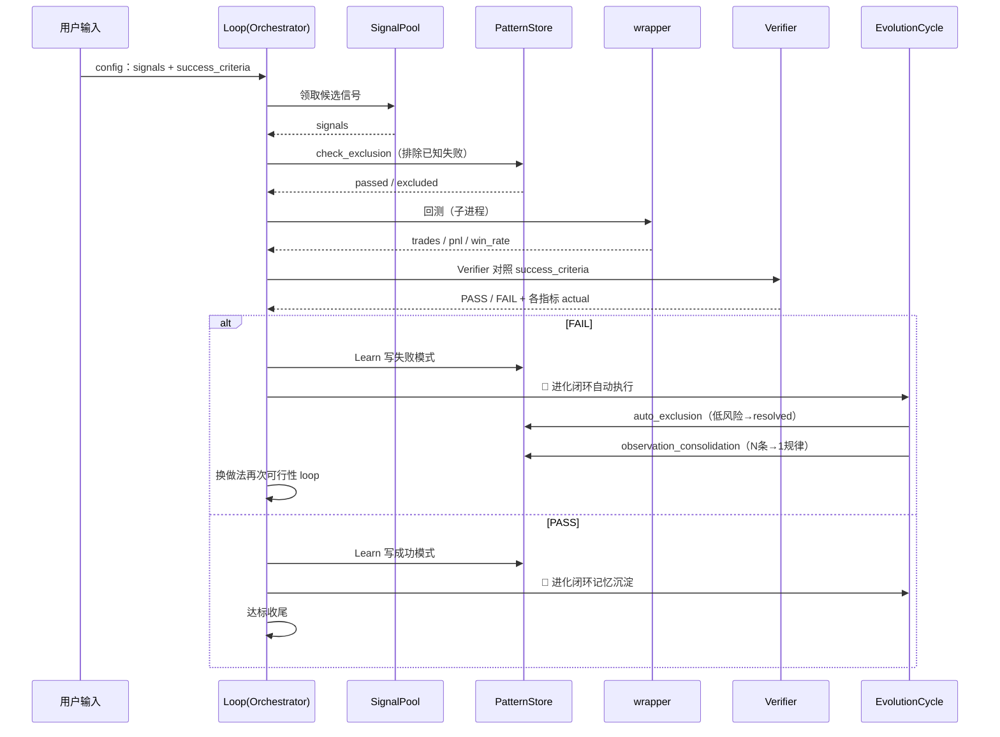
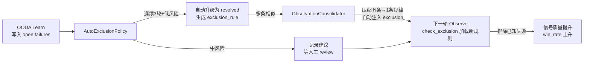
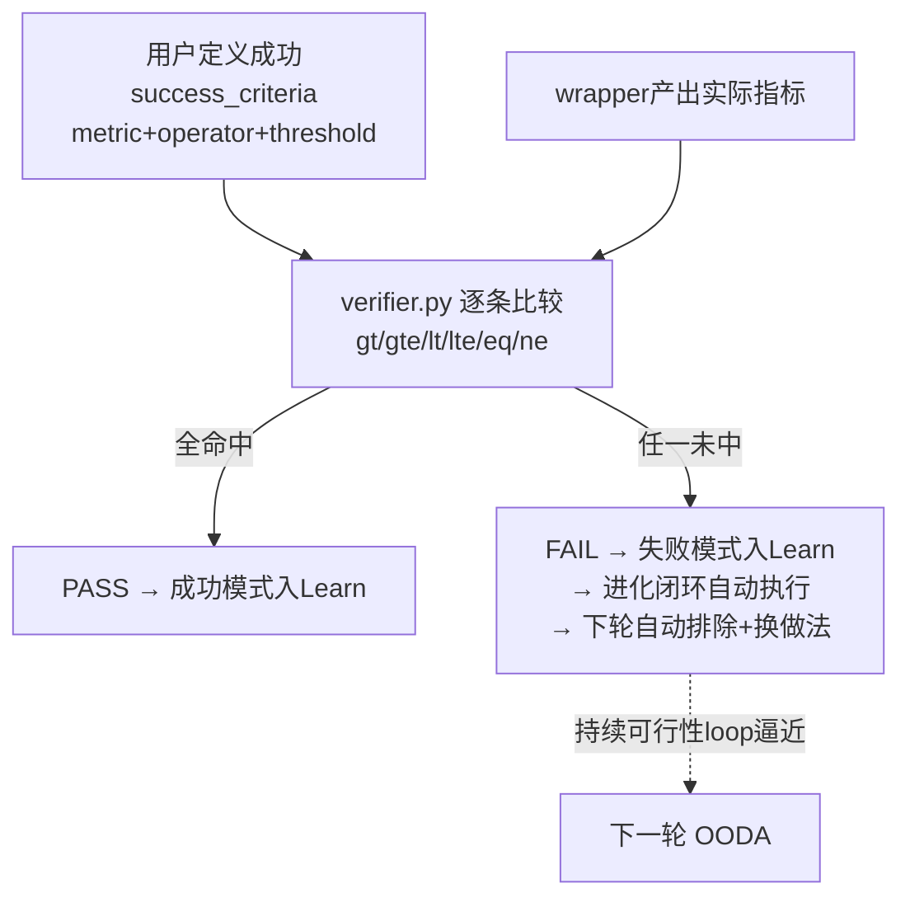

---
skill_family: project
skill_type: full-project-overview
project: loop-dev-0927
evaluatedAt: "2026-10-08"
input_ref: references/input-format.md
renderer: scripts/render.cjs
status: covered
---

# loop-dev-0927 · 后续开发进度与路线（完整项目规划）

> 基于当前基线（2026-10-08）梳理，整合 ROADMAP + agent研究学习 + 自我进化流程 + DSH对比。面向后续接手 Agent。

## 1. 结论

loop-dev-0927 是一个**CLI驱动的自进化编排框架**，核心循环：用户定义成功标准 → OODA 7步自主靠近 → 失败沉淀/成功复用。当前基线：791 passed，coverage 71.91%。已完成：DSH 12插件全面移植、EvolutionCycle v1.1 进化闭环、报告子任务树归并（runs/<run_ts>/不覆盖）、全局插件自包含。

**开发路线分三期**：P0（本周可做，低风险高价值）→ P1（下周，完善插件生态/可写界面）→ P2（长期，平台化/高级进化）。分配了 6 个具体任务块，每块含验收标准。



## 2. 全景架构图

loop-dev-0927 的当前架构：入口层（CLI / config）→ 编排层（OODA 7步）→ 执行层（backtest_adapter / wrapper）→ 持久层（PatternStore / EventLog / Checkpoint）。插件系统全局启用、跨任务共享；EvolutionCycle 在 Learn 后自动执行进化闭环。



## 3. 架构分层与模块地图

| 层/模块 | 职责 | 证据 |
|---------|------|------|
| `orchestrator.py` | CLI 组合根：加载配置 + 编排 OODA | ~820行（godfile拆分后） |
| `run_once_pipeline.py` | 单轮 OODA 7步管线 + 进化挂载 | ~550行 |
| `evolution/auto_exclusion_policy.py` | open→resolved自动升级 + 回测健康检查 | ~190行 新增v1.1 |
| `evolution/observation_consolidator.py` | N条失败→1条规律 + root_cause一致性 | ~140行 新增v1.1 |
| `evolution/plugin_driver.py` | RAG/workflow/记忆接入OODA | ~140行 新增v1.1 |
| `evolution/evolution_cycle.py` | 进化周期编排器（Learn后自动执行） | ~100行 新增v1.1 |
| `memory_store.py` | SQLite模式库 v001-v005 | ~540行 |
| `event_log.py` | JSONL 事件日志（事实源） | ~300行 |
| `ooda_pipeline.py` | OODA 7步实现（含Learn mixin） | ~800行 |
| `verifier.py` | 对照success_criteria判定 PASS/FAIL | ~60行 |
| `plugin_bootstrap.py` | 全局插件引导 + 路径自包含解析 | ~150行 |
| `plugin_loader.py` | PluginHost 发现/加载/激活 | ~220行 |
| `tool_registry.py` | 工具注册表（DSH移植） | ~120行 |
| `adapters/backtest_adapter.py` | Loop 与回测代码唯一耦合点 | ~200行 |
| `adapters/task_runner.py` | TaskRunner ABC + BacktestRunner | ~150行 |
| `runtime_paths.py` | fail-closed 路径隔离 | ~170行 |
| `runtime_exec.py` | ExecGate：去shell+解释器白名单 | ~115行 |
| `circuit_breaker.py` | 熔断半开多探针恢复 | ~110行 |
| `resume_guard.py` | 断电/崩溃恢复幂等 | ~80行 |
| `plugins/(6类/17子包)` | DSH 12核心插件 + 4 scaffold模板 | 全局启用 |
| `evolution_bridge.py` | 半自主信号演化（遗传算法） | ~120行 默认关闭 |
| `self_modify_gate.py` | 自改码安全门禁（patch→沙箱→提交/丢弃） | ~180行 |
| `webui.py` | FastAPI 只读看板 + /api/* 15路由 | ~120行 |
| `run_reporter.py` | 报告生成 + 子任务树归档 | ~250行 |
| `report_util.py` | runs/<run_ts>/REPORT.md 不覆盖 | ~100行 |

## 4. 任务运行与自主 loop 流程

**设计者视角**：

loop-dev-0927 的核心流程是：用户在 config 定义成功标准（`task.success_criteria`），Loop 用 OODA 7步自主循环逼近。每次 Learn 后自动执行进化闭环（auto_exclusion + observation_consolidation + plugin_driver），下一轮 Observe 自动加载新排除规则。



**进化闭环放大**：



## 5. 成功判定机制

loop-dev-0927 的成败由用户在输入里定义。成功值=判定式，不是必然值。写成 `task.success_criteria`（至少1条，PM模板要求≥3条）：`[{metric, operator, threshold}]`。更严格的正确性判定走 `verification.assertions`。



**进化闭环的成功判定**：
- AutoExclusionPolicy 自动排除成功 = open failures 降为 resolved 且有 exclusion_rule
- ObservationConsolidator 成功 = N条相似失败 → 1条规律 → 自动注入 exclusion
- 进化闭环整体成功 = 排除规则积累 → 信号池纯净度提升 → win_rate 可见上升趋势

## 6. 质量维度覆盖矩阵

| 维度 | 状态 | 证据 | 风险 |
|------|------|------|------|
| 架构完整性 | covered | orchestrator拆分 ~3300→820行；OODA 7步完整 | low |
| 插件生态 | covered | DSH 12插件全移植 + 全局启用 + 共享存储 | low |
| 进化闭环 | covered | EvolutionCycle v1.1（auto_exclusion + observation_consolidation + plugin_driver） | low |
| 测试覆盖 | covered | 791 passed；coverage 71.91% | low |
| 数据安全 | covered | provenance SHA + checkpoint 硬校验 + containment | low |
| 文档 | covered | docs/ 全套 + ROADMAP + USAGE + 本报告 | low |
| Profile/Bundle | missing | 无一键切换插件组合能力 | medium |
| 工具审批链 | missing | 无 pre/post hook waterfall | medium |
| 插件发现 | missing | 缺 plugin_registry 本地扫描索引 | medium |
| webui 可写 | missing | 有 /api/approve 但前端未接 | medium |
| MentalModels | missing | 缺从成功模式统计最佳参数 | low |
| EventLog 标准化 | partial | 有 JSONL 但事件类型未与 DSH 对齐 | low |
| TokenTracker | missing | 有 soft budget 契约但无实际计量 | low |
| 平台化 REST | missing | 无外部 HTTP 触发 + 多项目隔离 | high(gated) |
| OS sandbox | missing | 仅 dev containment（路径断言） | high(gated) |

## 7. 各模块详细分析

### 7.1 EvolutionCycle v1.1（进化闭环）

- **原则**：Learn 后自动执行 auto_exclusion + observation_consolidation + plugin_driver，不替代人工 review，只补充低风险自动处理
- **证据**：`evolution/` 目录下4个Python模块 + orchestrator 接入 + run_once 挂载点
- **风险**：low — 失败降级不影响主流程；回测健康检查 + root_cause 一致性已通过破框验证
- **下一步**：在实际项目中多轮跑通验证进化趋势；增加规则膨胀监控

### 7.2 DSH 插件系统

- **原则**："万物皆插件" — 12 核心 DSH 插件全部移植为 Python 版，全局启用、跨任务共享
- **证据**：plugin_config.yaml roster 12 插件 trusted；plugin_bootstrap 自包含路径解析
- **风险**：low — 插件已全局启用并在 0917 测试通过
- **下一步**：P0 补 plugin_registry（本地扫描索引）+ Profile/Bundle（一键切换）

### 7.3 自我进化流程

- **原则**：从 Hindsight + DSH 学到的核心能力已落地 — 失败沉淀 → 自动排除 → 模式压缩 → 插件增强
- **证据**：`docs/loop-dev-自我进化流程模板-v1.1.md` + Hindsight 对比分析
- **风险**：medium — Phase 2 MentalModels 未实现；Grand-Loop 自动编排未落地
- **下一步**：P1 实现 MentalModels 规则版（从成功模式统计最佳参数）

### 7.4 报告与归档

- **原则**：runs/<run_ts>/ 子任务树归并，多次运行互不覆盖，快照同树
- **证据**：report_util.py + run_reporter.py + run_state.py 三处联动；test_subtask_tree.py 7项
- **风险**：low — 已三轮验证通过
- **下一步**：P2 加 _index.json 聚合索引 + 保留策略

## 8. 问题点汇总统计

质变维度统计（来自 §6 覆盖矩阵 + P0/P1/P2 三期的具体任务块）：

| 状态 | 数量 | 说明 |
|------|------|------|
| covered | 7 | 架构/插件/进化闭环/测试/安全/文档/报告 |
| partial | 2 | EventLog标准化、webui后端有API前端未接 |
| missing | 6 | Profile/Bundle、工具审批链、plugin_registry、webui可写界面、MentalModels、TokenTracker |
| gated(high) | 2 | REST API、OS sandbox |

## 9. 开发路线 — 三期分阶段

### 🔴 P0（本周可做 · 低风险高价值 · 3个任务块）

| 编号 | 任务 | 现状 | 要做 | 验收 | 工作量 |
|------|------|------|------|------|--------|
| **P0-1** | Profile/Bundle 一键切换 | cordis 概念未移植 | 在 plugin_config.yaml 新增 profiles: 段；每个 profile = 一组插件 roster + 配置 overlay；`--profile <name>` 一键切换 | 切换 profile 后插件激活列表不同；测试固化 | 0.5天 |
| **P0-2** | 工具审批链 pre/post hook | ToolRegistry 无 chain | 在 ToolRegistry.dispatch 前后加 pre_hook/post_hook 列表；插件可注册 hooks；审批/审计/拦截 | 危险工具被 pre_hook 拦截；单测覆盖 | 0.5天 |
| **P0-3** | plugin_registry 本地扫描索引 | 缺发现入口 | `plugin_registry.py` 扫描 plugins/ 所有 manifest + 生成索引（含已安装/未激活）；CLI `--list-plugins` | 列出全部可用插件及状态；可在 loop-dev-0927 自测试 | 0.5天 |

### 🟠 P1（下周 · 完善插件生态 · 3个任务块）

| 编号 | 任务 | 现状 | 要做 | 验收 | 工作量 |
|------|------|------|------|------|--------|
| **P1-1** | MentalModels 规则版 | ObservationConsolidator 已做压缩 | `evolution/mental_model.py`：定义问题模板 → 从 PatternStore 统计最佳参数/最优止盈等 → 预计算答案缓存；下次同场景直接使用 | 创建 mental model 后获取预计算答案；单测覆盖 | 1天 |
| **P1-2** | EventLog 标准化 | JSONL 有但事件类型不统一 | 对齐 DSH 事件类型（turn/step/tool/result）+ 标准化 event schema；补 event doc | validate.mjs 通过事件类型校验 | 0.5天 |
| **P1-3** | webui 可写界面 | 后端有 /api/approve 但前端未接 | 在 static/index.html 增加规则审批/队列操作/建议交互的 UI 控件；调用已有 /api/rules/{id}/approve 等 | 浏览器可 approve/reject 规则；单测更新 | 1天 |

### 🟡 P2（长期 · 触发条件达到再启动）

| 编号 | 任务 | 触发条件 | 参考文档 |
|------|------|----------|----------|
| **P2-1** | REST API + Webhook | 出现第2个真实多模块任务 | ROADMAP §2 🟠 P1 |
| **P2-2** | Grand-Loop 自动编排 | EvolutionCycle 在实际项目中跑通 | GRAND-LOOP.md |
| **P2-3** | OS/network sandbox | 暴露给不可信输入前 | ROADMAP §2 🟡 P2 |
| **P2-4** | TokenTracker | 需要成本核算时 | DSH 对比 P0-2 |
| **P2-5** | fail-closed CI | 多人/多机协作时 | ROADMAP §2 🔴 P0 |

## 10. 使用者视角 · 运行任务 / 查询历史 / 自主 loop

**零. 环境准备**（一台新主机）:
```bash
py -3.11 -m venv .venv
.venv\Scripts\python.exe -m pip install PyYAML pytest pytest-cov coverage fastapi uvicorn httpx
```

**一. 定义成功**:
在 config.yaml 写 `task.success_criteria` ≥1 条；PM 模板 ≥3 条；operator 仅 gt/gte/lt/lte/eq/ne。

**二. 运行**:
```bash
python orchestrator.py --config config.pilot-lh.yaml --doctor    # 环境自检
python orchestrator.py --config config.pilot-lh.yaml --once       # 单轮 OODA 7步
python orchestrator.py --config config.pilot-lh.yaml              # 持续循环
```

**三. 查询**:
```bash
python orchestrator.py --history     # 运行历史
python orchestrator.py --status      # 模式库/问题队列
python orchestrator.py --inspect runs | timeline | round --round N
python orchestrator.py --trace       # 本地 HTML 报告
```

**四. 进化状态**:
```bash
python orchestrator.py --status      # 查看 exclusion rules 数量变化
# 进化闭环自动执行；趋势在 _orient 中输出
```

**五. 恢复/审核**:
```bash
python orchestrator.py --resume                     # 断电恢复
python orchestrator.py --review --yes --scope combo  # 人工审核升级排除规则
```

**六. Profie 切换（P0-1 完成后）**:
```bash
python orchestrator.py --profile pm --once           # 用 pm profile 运行
python orchestrator.py --list-plugins                # 查看可用插件（P0-3）
```

**七. webui**:
```bash
python -m loop-engine.webui --data-dir E:/loop-runtime/pilot-lh/data --port 8710
# 浏览器打开 http://127.0.0.1:8710
```

## 11. 关键发现

1. **EvolutionCycle v1.1 是最重要的基础设施** — 它让 loop-dev 从"人工驱动"真正进入"自动进化"。AutoExclusionPolicy + ObservationConsolidator 构成了完整的 Learn→排除→压缩→下次生效 闭环。

2. **DSH "Everything is a Plugin" 已完全对齐** — 12 核心插件全移植，全局启用，共享存储。差距在"生态层"（plugin_registry/Profile/市场）而非"骨架层"。

3. **Hindsight "observations + mental models" 已部分落地** — ObservationConsolidator 实现了模式压缩；MentalModels 规则版规划在 P1。

4. **报告子任务树归并已完成** — `runs/<run_ts>/` 下 REPORT.md + data/ 同树，多次运行互不覆盖。这是 0927 修复的核心成果。

5. **当前最大缺口在 P0** — Profile/Bundle 一键切换 + 工具审批链 + plugin_registry。这些都是"低风险高价值"项，做完后 0927 的插件体系就完整了。

6. **loop-dev-0927 定位已明确** — 确定性编排框架，LLM 辅助但不替代，个人/小团队工具。不学 Hindsight 的企业级部署，不学 DSH 的 60+ 集成适配器。

## 12. 加固建议

1. **P0 优先做 Profile/Bundle** — 这是最有价值的"一键切换"能力，让多场景（PM测试 / 蒸馏 / 架构评估）无缝切换。
2. **P0-2 工具审批链** — 对接 pre/post hook 后的审批机制，让危险操作有拦截层。
3. **P1 的 MentalModels 规则版** — 这是从 Hindsight 学到的最有价值能力：预计算答案，不重复探索。
4. **规则膨胀监控** — EvolutionCycle 长期运行后，exclusion_rules 可能累积到数百条；需定期审查+合并相似规则（可用 ObservationConsolidator 反向做规则合并）。
5. **保留自主进化的搁置状态** — evolution_bridge / self_modify_gate 已完成但搁置，等待运行条件恢复后按 ROADMAP §4b 唤醒。

## 13. 下一步

按既定优先级：

| 顺序 | 任务 | 状态 |
|------|------|------|
| 1 | **P0-1** Profile/Bundle 一键切换 | 📋 本周 |
| 2 | **P0-2** 工具审批链 pre/post hook | 📋 本周 |
| 3 | **P0-3** plugin_registry 本地扫描索引 | 📋 本周 |
| 4 | **P1-1** MentalModels 规则版 | 📋 下周 |
| 5 | **P1-2** EventLog 标准化 | 📋 下周 |
| 6 | **P1-3** webui 可写界面 | 📋 下周 |
| 7 | P2 gated 项 | 触发条件达到才启动 |

**接手顺序**（新 Agent 接手时）：
1. 读 §1 结论了解全貌
2. 读 §2 架构图建立心智模型
3. 读 §9 按 P0→P1→P2 顺序执行
4. P2 项均为 gated，不要抢跑
5. 改动后跑 `pytest` + `scripts/run_gate.py` 验证

---

*生成时间: 2026-10-08 · 基线: loop-dev-0927 · 测试: 791 passed · 基于 ai-skill-output-template project.overview 模板*