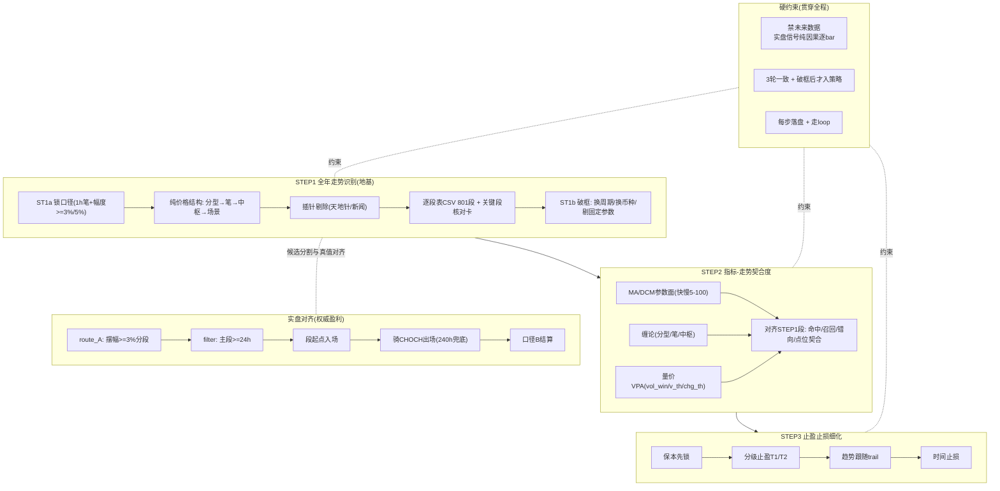
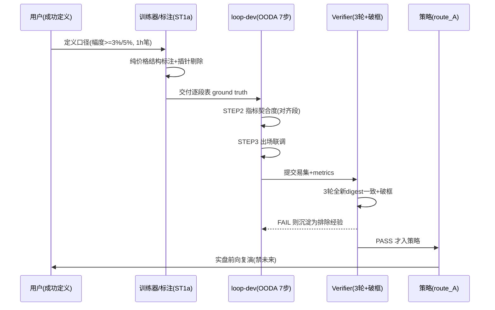
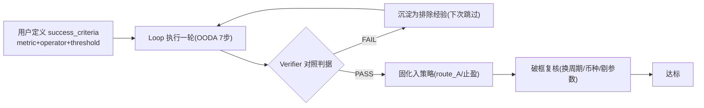

# PM 量化训练全流程（可复制的成功/出错步骤 · 大步骤×小步骤）

## 结论

本文把 PM 量化训练从 2026-07-28 到 2026-10-03 的全过程，拆成 STEP1 走势识别(地基) → STEP2 指标-走势契合度 → STEP3 止盈止损 三步漏斗，并逐条记录每一步的成功步骤与出错步骤/淘汰结论——因为只有这些才可复制。三个硬约束贯穿全程：禁未来数据(实盘信号纯因果逐bar；训练/校验阶段允许全量未来建 ground truth)、结论3轮一致+破框后才入策略、每步落盘且走 loop。当前权威盈利路线是 route_A(摆幅分段>=3%→主段>=24h→段起点入场→骑CHOCH出场)，ETH/BTC/SOL 分别 321/259/327 笔，3轮md5一致、禁未来 audit_bad=0。

## 2. 全景架构图

PM 量化训练是一条「先校准基准、再校准探测器、最后校准出场」的三步漏斗，每一步都以「3轮一致+破框」作为收尾闸门，并通过 loop-dev 的 OODA 7 步把失败沉淀为排除经验、把成功复用为优先信号。整体分两层口径：训练/校验层允许用全量未来数据建立 ground truth(哪些是真行情)，实盘决策层只许用确认时点 T 之前的历史(纯因果、可复现)。图示如下：



一句话读图：STEP1 建 ground truth → STEP2 用指标去探测那个基准 → STEP3 只对已确认有效点位优化出场；实盘则复用 STEP1 的摆幅分段做候选、用主段>=24h 过滤，其余指标只作为各自的探测/确认层。

## 3. 架构分层与模块地图

| 层/模块 | 职责 | 证据 |
| --- | --- | --- |
| STEP1 全年走势识别(地基) | 纯价格结构(分型→笔→中枢→场景)切分走势段，产出 ground truth(真可捕获段) | PM量化三步自顶向下设计文档-v2.md STEP1 §1.1-1.4 |
| STEP1a 锁口径+逐段表 | 写死判定口径(1h笔+|幅度|>=3%/5%)→产 801 段 CSV + 关键段手动核对卡 | 设计文档v2 附B [ST1a] |
| STEP1b 破框收尾 | 换周期/换币种/剔固定参数三关，量化失败判据(>=3%段识别率>=90%) | 设计文档v2 附A 异议5 |
| STEP1c 插针剔除 | 天地针/新闻插针判定(amp>max(2%,4*med)+12h回补)不进 ground truth | 设计文档v2 附C §C.2 |
| STEP2 指标-走势契合度 | MA/DCM参数面 + 缠论 + 量价，算命中/召回/错向/点位契合，对齐STEP1段 | 设计文档v2 STEP2 §2.3 |
| STEP2 循环隔离 | STEP1只许纯价格结构，STEP2才引指标，防自证(misuse of same lens) | 设计文档v2 附A 异议2 |
| STEP3 止盈止损细化 | 保本锁+分级止盈+趋势跟随+时间止损，场景自适应非一刀切 | 设计文档v2 STEP3 §3.2 |
| STEP3 模拟实盘口径 | 1000U/下单1%(cap3%)/剩余保证金/100x/滑点0.05%x2+费0.02%x2 | 2026-09-29-三套指标实盘测试代码集-3轮既定模式校验结论.md 资金口径段 |
| 硬约束 禁未来数据 | 实盘信号纯因果逐bar；训练/校验阶段允许全量未来建 ground truth | 2026-09-22-PM-行情识别与信号决策的逻辑分层.md §6.1/6.3 |
| 硬约束 3轮一致+破框 | 结论须3轮全新digest一致且破框后才入策略 | 2026-09-21-PM-量化主线结论蒸馏与状态标签总表.md 核心纪律行 |
| route_A 权威盈利路线 | 摆幅分段(>=3%)→主段>=24h→段起点入场→骑CHOCH出场(240h兜底)→口径B | 2026-09-25-PM-路线A定案挂载loop-dev验收蒸馏.md 二.挂载方案 |
| filter 主段>=24h | 盈利核心拦截器：剔除<24h短噪音wipsaw段(全覆盖n593必亏→主段n321盈利) | 2026-09-29-三套指标实盘测试_权威盈利方案对齐_结论.md 结论2 |
| 资金口径B | notional=min(eq*PCT,2000),margin=notional/杠杆; 8W来自满仓名义非1% | 2026-10-02-破框确认-实盘与回测一致性审计-资金口径真相.md 不一致项1 |
| loop-dev 编排 | OODA 7步；wrapper输出trades+metrics；Verifier对照success_criteria | 2026-09-25-PM-路线A定案挂载loop-dev验收蒸馏.md 三.本轮修复 |
| PM-LESSONS 反走偏清单 | L1-L16+L99-L104 跨runbook长存，唤醒先读 | 99-工作日志/PM-LESSONS-LEARNED.md 维护纪律行 |
| qupm-loop 接入资产 | PM→loop 唯一接入权威(Hook协议/记忆层/自进化) | qupm-loop/PM-Loop接入方案.md |

## 4. 任务运行与自主 loop 流程

训练分三大阶段，每阶段都有「成功步骤(checkpoint)」与「出错步骤/淘汰结论(negative)」两类可复制经验。

全链路总流程(设计者视角)：



STEP1 成功步骤：锁定口径(1h笔+幅度>=3%/5%) → 纯价格结构(分型→笔→中枢→场景, 大周期聚合4h/6h/1D) → 插针剔除(amp>max(2%,4*med) 且 12h内回补判插针) → 交付逐段表(ETH-2026 801段/113个>=3%/37个>=5%) → 关键段手动核对(2026-06真底1503、2025-04底1382) → 3轮digest一致 → 破框(换周期/换币种/剔固定参数, 判据>=3%段识别率>=90%)。

STEP1 出错步骤/淘汰结论：① 时间切片识别趋势(V1小时切片, 时间驱动非价格驱动, 废弃)；② 摆动点+缠论笔交叉验证(V2, 粒度不匹配0.7% vs 1.8%, 准确率25%, 废弃)；③ MA/均线参与标走势(循环论证 misuse of same lens, 禁止)；④ 不剔插针(会把170根尖刺误计为>=3%段, 污染ground truth)；⑤ K线合并不聚合直接1h单级(过度塌缩 5256→25)。

STEP2 成功步骤：指标参数面遍历(MA快慢5-100组合、EMA/SMA/WMA变种；DCM动量/基准；缠论分型窗口/笔确认/中枢延伸；量价vol_win/v_th/chg_th) → 每个信号映射到STEP1已确认段 → 度命中/召回/错向/点位契合 → 3轮一致+破框收尾 → 结论形态=「该指标在哪类走势/哪段有效, 在哪类失效」而非好坏。

STEP2 出错步骤/淘汰结论：① MA(EMA21/89)交叉作唯一信号源(大行情0/错向, 降为动量辅助)；② 斐波那契档位(0.5/0.618/0.786)判反转(反转档仅14%, 无效, 仅参考价)；③ 一刀切逆势跳过(实证净有害-40%, 应分场景)；④ entry-gate 5连FAIL族确认(任何熊段全禁BUY必同族失败, L13)；⑤ 蜂群小样本外推全样本(R6证伪, 逆势59单整体+42.25)。

STEP3 成功步骤：保本先锁 → 分级止盈(每级记录触发时间与价格) → 趋势跟随(让利润飞) → 时间止损(场景收紧)；模拟实盘口径(1000U/下单1%cap3%/剩余保证金/100x/滑点+手续费) → 逐笔记录(下单/止盈/止损时间点位+权益) → 3轮一致+破框 → 月度完全月正收益占比。

STEP3 出错步骤/淘汰结论：① 固定-1.2%硬止损(趋势内大肉必被反弹扫掉)；② ATR trailing任何变体(与下跌续持互斥, T0134必撞SL)；③ 逆势SL收紧/逆势skip/vol-价格分档(R6/R8/R6c 均read-only先验判NO, 大赢与bleed全维共存)；④ 时间兜底太短(cap=48h把大反转提前砍到WR 78.6%, ETH档240~720h)；⑤ 100x反向1%强平与最大盈利持有数学互斥(需低杠杆+宽止损)。

实盘对齐段(route_A)：摆幅分段>=3% → 主段>=24h filter → 段起点入场(入场价=确认时点收盘) → 骑CHOCH反转出场(240h兜底) → 口径B结算。退出已验证的三大方向(勿重试)：入段过滤/次级别突破确认、降分割阈值3→2→2.5%、扩展候选加pct>=7%。

查询与复跑(使用者视角)：本地3轮校验 `python validate_all.py [coin]`(约3~4分钟)；实盘前向复演 `route_a_live_runner.py`；loop 任务 `projects/pm/<task>/` 用 config.yaml+wrapper.py+data/signals.json 三件套，`orchestrator --config ... --doctor|--once`；3轮一致性以产物 md5 对齐(如 routeA 定案 md5=A85C0C0288E89A7BCCF87D5102FC452A)。

## 5. 成功判定机制 · 用户定义·Loop 逼近

「什么算成功」由用户显式定义，Loop 按判定式逐轮逼近，而不是编排器自己说了算——编排器不是计算器。
- 确定性结果：像 1+1=2 这类真值，一次命中即成功(如 3轮全新 digest 逐位一致)。
- 复杂目标：拆成可判定的判定式，按可行性 loop 逼近。PM 训练的成功判定式有三类：
  1. 一致性判据：同一任务连跑3遍 md5 完全相同(routeA 定案 md5=A85C0C0288E89A7BCCF87D5102FC452A；09-29 三轮csv md5全一致)。
  2. 因果判据：audit_no_future 全过 / lookahead_violations=0 / audit_bad=0(入场只用T前, 出场只用entry后bar)。
  3. 效果判据：覆盖>=3%行情段比例(route_A 84.4% vs 基线46.5%)、胜率、期末U、完全月正收益占比。



分工初衷：编排器不是计算器——它负责把用户写明的成功定义跑成循环并自我纠偏；「值」的正确性(因果/一致/覆盖)由 Verifier 对照判据强制，不靠 Agent 主观宣布。

## 6. 质量维度覆盖矩阵

| 维度 | 状态 | 证据 | 风险 |
| --- | --- | --- | --- |
| STEP1 走势识别口径锁定 | covered | 设计文档v2 STEP1 §1.3 交付 801段/113个>=3%/37个>=5%段 | low |
| STEP1 破框收尾(周期/币种/参数) | partial | 设计文档v2 附A 异议5 定义了>=3%段识别率>=90%判据但未全部执行 | medium |
| STEP1 插针剔除规则 | covered | 设计文档v2 附C §C.3 交付 170候选 wicks_detect.csv | low |
| STEP2 指标参数面覆盖 | partial | 2026-09-24-MA-DCM全参数扫描结论蒸馏.md 覆盖MA/DCM；三指标独立回测见 三指标优缺点与回测结论.md | medium |
| STEP2 循环论证隔离 | covered | 设计文档v2 附A 异议2：STEP1只许纯价格结构 | low |
| STEP3 分级止盈落地 | partial | 2026-09-25 路线A定案蒸馏 §五：骑CHOCH=分级止盈实现；逐级时间记录待补 | medium |
| STEP3 止损口径统一 | missing | PM-LESSONS-EXIT-REUSE-2026-09-13.md 景10 tight 是新造变体(NO)；SL体系文档分散 | high |
| 禁未来数据(实盘信号) | covered | 2026-09-29 三套校验结论 audit_no_future 全过；2026-10-02 口径真相 audit_bad=0 | low |
| 训练/校验允许未来的分层口径 | covered | 2026-09-22-PM-行情识别与信号决策的逻辑分层.md §6.1/6.4 | low |
| 3轮一致+破框收货 | covered | 2026-09-25 路线A定案 3遍md5 A85C0C02 一致；09-29 三轮csv md5全一致 | low |
| 资金口径一致性(回测=实盘) | partial | 2026-10-02 口径真相 不一致项1：8W=满仓名义非1%，已修正route_a_live | high |
| route_A 交易集对齐 | covered | 2026-10-02-routeA权威方案-实盘前向复演.md：3轮md5一致 missing=0/extra=0 | low |
| 实盘顺势门逐字节对齐 | missing | 2026-10-02 口径真相 不一致项3：需重建因果ST1a线段检测 | high |
| 入场信号源合法性(弃140) | covered | 2026-09-21 蒸馏总表 §一.1：132/140 为后见口径已彻底放弃 | low |
| 失败经验闭环入库 | covered | 99-工作日志/PM-LESSONS-LEARNED.md L12 入库判据 removed_direct_sum>0 | low |

## 7. 各模块详细分析

### STEP1 走势识别
- 原则: 先校准基准(ground truth)再谈探测器；走势图是基准，指标是探测器
- 证据: PM量化三步自顶向下设计文档-v2.md 总纲 + L12-14 分型→笔→中枢→场景
- 风险分级: low (scheme 一.3)
- 下一步: 补齐STEP1b破框三关量化判据执行

### STEP2 指标契合度
- 原则: 每个指标信号必须映射到STEP1已确认走势段，判命中/召回/错向/点位
- 证据: 设计文档v2 §2.3；三指标优缺点与回测结论.md
- 风险分级: medium (scheme 一.4)
- 下一步: 补全MA变种(SMA/EMA/WMA)5-100全参数面

### STEP3 止盈止损
- 原则: 场景自适应非一刀切；保本先锁+分级+趋势跟随+时间止损
- 证据: PM量化三步自顶向下设计文档-v2.md L3.2 + PM-LESSONS-EXIT-REUSE-2026-09-13.md 铁律段
- 风险分级: high (scheme 二.2)
- 下一步: 收敛SL体系为单一权威口径文档+逐级时间记录

### route_A 权威路线
- 原则: 行情覆盖主杠杆=候选分割与ST1a真值对齐，而非过滤/确认技巧
- 证据: 2026-09-25-PM-Truth对齐-每个行情段都吃上-决定性收敛.md：覆盖46.5%->84.4%
- 风险分级: low (scheme 一.3)
- 下一步: 破框三段复核+参数敏感性

### 禁未来/分层口径
- 原则: 训练校验含未来合法，实盘信号含未来禁止；先训练校验后实盘
- 证据: 2026-09-22-PM-行情识别与信号决策的逻辑分层.md L6.4 一句话总结
- 风险分级: low (scheme 一.2)
- 下一步: 固化C1/C2/C3 correctness gate入loop success_criteria

### loop-dev 编排与经验闭环
- 原则: 出数据皆经orchestrator；失败沉淀为排除经验
- 证据: L101/L102 守门器；L12 入库判据
- 风险分级: medium (scheme 一.4)
- 下一步: wrapper输出metrics+config硬门槛全量推广

## 8. 问题点汇总统计

| 风险级 | 计数 | 涉及维度 |
| --- | --- | --- |
| critical | 0 | - |
| high | 3 | STEP3 止损口径统一,资金口径一致性(回测=实盘),实盘顺势门逐字节对齐 |
| medium | 3 | - |
| low | 9 | - |

覆盖状态：covered=9 partial=4 N/A=0 missing=2

## 9. 改进方案 — 阻塞项详述

### B1
- 现象: 止损体系文档分散，曾出现已被否证的逆势SL收紧变体
- 根因: SL体系(2ATR/floor0.012/AGB/weak0.003/override)未收敛为单一权威口径文档
- 影响: 重复造轮子，8分钟真sim重证高概率NO结果
- 验证: PM-LESSONS-EXIT-REUSE-2026-09-13.md 铁律段 + 景10 tight net 72.108->42.574

### B2
- 现象: 实盘门方向=6h笔代理，回测门=ST1a冻结线段GT
- 根因: 现有代码库不含ST1a因果线段生成器(只有读者)
- 影响: 门语义接近恒真/不完全对齐，逐字节一致不可达
- 验证: 2026-10-02-破框确认-实盘与回测一致性审计-资金口径真相.md 第6节

### B3
- 现象: route_A 8W 与 1%方案收益量级不一致(约1/100)
- 根因: notional=min(eq,2000)满仓名义 vs notional=eq*1%
- 影响: 资金曲线与实盘预设口径冲突，易误读盈利
- 验证: 2026-10-02 口径真相 不一致项1 + route_a_live.py 修正

## 10. 使用者视角 · 运行任务 / 查询历史 / 自主 loop

环境准备：Python 3.11+；`pip install numpy pandas pyyaml pytest`；loop-dev 目录 `E:\业余\my\loop-dev`。

运行一次训练/校验任务：
```bash
cd E:\业余\my\loop-dev\loop-engine
python orchestrator.py --doctor        # 环境自检(验python/yaml/patterns/script/contract)
python orchestrator.py --status        # 查模式库(失败/成功经验)
python orchestrator.py --config projects/pm/<task>/config.yaml --once   # 单轮 OODA
```

本地三套指标3轮校验(runtime_code)：`python validate_all.py [ETH|BTC|SOL]`(全跑约3~4分钟)；产物 `results/<engine>/<coin>_{1,2,3}.csv`，判定=三轮csv md5全一致且 audit_no_future 全过。

实盘前向复演(route_A)：`route_a_live_runner.py` 持久化累计已收盘1h帧到 `<coin>_routea_1h.csv`，每 tick 对累计closed历史跑 run_route，仅记录已定稿出场(CHOCH/TIME_OUT, 非DATA_END)的单。

查询历史/复跑：loop 产物在 config 指定的 runtime.root(仓库外)下的 STATE.md / IMPROVEMENTS.md / REPORT.md / runs 快照；权威CSV在 `runtime2026/results/qd_compare/定案/`。

唤醒口径：任何 Agent 接手先读 `00-总览/2026-09-21-PM-量化主线结论蒸馏与状态标签总表.md`(最新锚点) → 再读 `99-工作日志/PM-LESSONS-LEARNED.md`(反走偏清单) → 再读 10_问题解决 细节 → 接续「四、下一步」。

## 11. 关键发现

1. 顺序铁律：先看清当下行情(基准) → 再用严格信号 → 最后过滤/裁决。场景层没验「正确」前，信号层结论一律 PROVISIONAL(L1)。
2. 口径分离：训练/校验用全量未来建 ground truth 合法；实盘信号用未来禁止。先训练校验、后实盘。
3. 主杠杆是候选分割对齐真值：route_A 覆盖从46.5%升到84.4%，靠的是候选分割与 ST1a 真值对齐，而非任何过滤/确认技巧。
4. filter主段>=24h是盈利核心拦截器：全覆盖n=593必亏，主段>=24h的n=321才盈利。
5. 入场filter扩展已diminishing：entry-gate 5连FAIL族确认，任何「熊段全禁BUY」必同族失败；解亏月应走 EXIT 侧或跨币，不在entry层再堆门。
6. 止盈与止损分属不同层：止盈=骑CHOCH(让利润飞+抗浮亏+结构反转落袋)；SL=既定体系(2ATR/floor0.012/AGB)。别再混谈、别新造变体。
7. 资金口径真相：8W来自满仓名义 notional=min(eq,2000)，非1%；1%方案同交易集约1/100。「8W=1%方案」是误解。
8. 跨实现须先对齐算法基石：两套 fractal/笔实现(是否continue)会让结论天差地别(L99)；跨脚本复用结构反转逻辑前必须逐字比对strokes。


## 12. 加固建议

1. 把「什么是正确」固化成 loop 判据：wrapper 输出 metrics(如 lookahead_violations / exit_time_px_mismatch / fees_basis_consistent)，在 config.success_criteria 追加 =eq/0 硬门槛，让 Verifier 自动 FAIL，loop 才能自我发现(L101/L102)。
2. 收敛止损口径为单一权威文档：把 2ATR / floor0.012 / AGB / weak0.003 / sl_override 一次写死，并标注「逆势SL收紧/skip/vol分档 = 已否证, 不再试」。
3. 建 ST1a 因果线段生成器：补齐与冻结GT逐字节一致的门，替代当前6h笔代理门。
4. 统一资金口径锚：route_A/runtime_code/实盘三处 notional 公式写明并回归测试，避免再次口径漂移。
5. 动前先验机制：动手前先用已落盘先验推演同类，能read-only判NO就不跑sim(iron law, 省8分钟/轮)。
6. 入库判据收紧：clean入库须 removed_direct_sum>0(真原理净移除净亏单)，仅总diff>0而direct~0属reshuffle驱动=FRAGILE不入库(L12)。


## 13. 下一步

1. 补齐 STEP1b 破框三关(换周期/换币种/剔固定参数)的量化判据执行，达到「>=3%段识别率>=90%」才算 STEP1 验收。
2. 补全 STEP2 参数面：MA 变种(SMA/EMA/WMA)与 DCM 快慢线 5-100 全组合测试(此前仅部分覆盖)。
3. 收敛 STEP3 止损为单一权威口径并补逐级止盈/止损时间记录(设计文档已要求，代码待落)。
4. 建 ST1a 因果线段检测模块，达成实盘门与回测逐字节一致(B2阻塞项)。
5. 三套引擎(缠论/VPA/MA-DCM)在 route_A 下各自独立账户/DB/止盈/日志，跑满一个月后对比各指标×各止盈方案结果。
6. 全流程 correctness gate 入 loop success_criteria，确保任何回测/实盘产物不过6道 gate 不得引用。

---

## 关联

- [[PM量化训练全流程-既定模式有效性评估-2026-10-10]]
- [[PM量化全流程执行总账-2026-09-23]]
- [[2026-09-21-PM-量化主线结论蒸馏与状态标签总表]]
- [[PM-LESSONS-LEARNED]]
- [[PM量化三步自顶向下设计文档-v2]]
