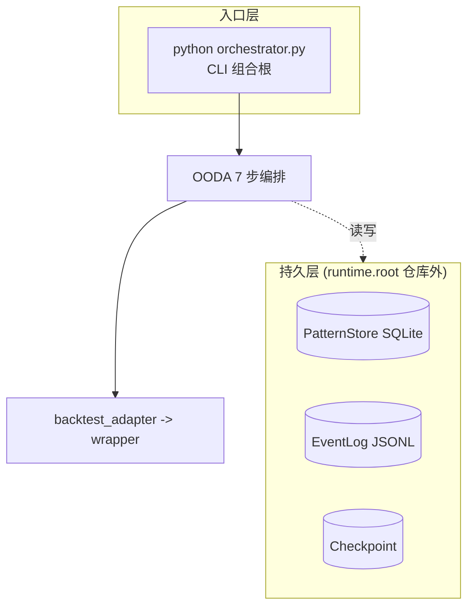

# L2 金样 — project 家族（完整项目介绍）

> 金样实例：2026-09-01 loop-dev 完整项目介绍报告。结构由 renderer 强制，LLM 只写 narrative。
> 此金样用于 project-overview 回归对照：章节顺序、mermaid 放置、双视角书面语都必须一致。

## 元信息
- project: loop-dev · family: project · template: project.overview · evaluatedAt: 2026-09-01 · tier: L2
- 输入契约：references/input-format.md（narrative 可含 ```mermaid）
- renderer: `node scripts/render.cjs samples/project.overview.input.json --template project.overview --out output/project/loop-dev/2026-09-01/report.md`
- 校验: `node scripts/validate.mjs ...report.md --template project.overview`

## 章节骨架（一份合格 project 介绍的必备）
| 序 | 章节 | 内容要求 | 来源 |
|----|------|---------|------|
| 0 | 结论 | 一句话定位 + 关键指标（测试数/覆盖率/接通态/下一步） | narratives.summary |
| 1 | 全景架构图 | mermaid flowchart 大图：入口→编排→执行→持久 + 一句数据流说明 | narratives.architecture |
| 2 | 架构分层与模块地图 | 表格：层/模块 职责 证据 | archMap[] |
| 3 | 任务运行与自主 loop 流程 | mermaid：怎么运行 / 自主 loop 时序 / 怎么查询历史 | narratives.taskFlow |
| 4 | 成功判定机制 · 用户定义成功 · Loop 近跟 | 显式写明“什么算成功”的判定式 + 自主 loop 近跟 + 并强调“编排器不是计算器”的分工初衷 | narratives.successCriteria |
| 5 | 质量维度覆盖矩阵 | 表格：维度 状态 证据 风险 | dimensions[] |
| 6 | 各模块详细分析 | 逐模块：原则/证据/风险/下一步 | skillAnalyses[] |
| 7 | 问题点汇总统计 | renderer 计算分级与覆盖 | dimensions[] |
| 8 | 改进方案 — 阻塞项详述 | 逐项：现象/根因/影响/验证 | blockers[] |
| 9 | 使用者视角 · 运行任务/查询历史/自主 loop | 完整命令速查 + 环境准备 + 常见路径 | narratives.usage |
| 10 | 关键发现 / 加固建议 / 下一步 | 三段人手写 | narratives.* |

## 可视化示例（mermaid 放在 narrative 内）



## 结构与校验
- 规格条款见 `spec/L1-project.md`。
- 校验通过标准：validate.mjs（template=project.overview）exit 0；章节齐全；至少 3 张 mermaid；架构图在最前（结论之后第一段）。
